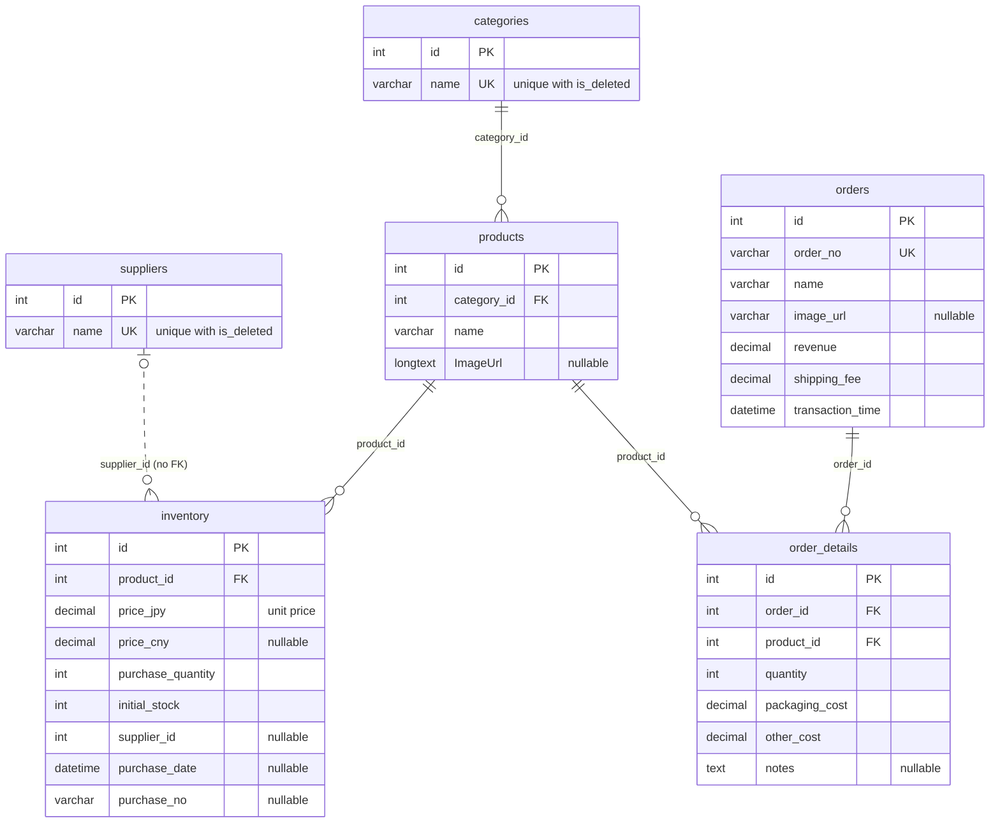

# Database Schema

This document describes the database structure, tables, relationships, and constraints in InventoryHub.

## Entity Relationship Diagram



Every table also has `created_at`, `updated_at` and `is_deleted`. See [Soft Delete Implementation](#soft-delete-implementation).

The dotted line has no foreign key in the database. `inventory.supplier_id` is a plain column.

## Tables

### Categories

Master table for product categories.

| Column       | Type         | Constraints                 | Description           |
| ------------ | ------------ | --------------------------- | --------------------- |
| `id`         | INT          | PRIMARY KEY, AUTO_INCREMENT | Unique identifier     |
| `name`       | VARCHAR(100) | NOT NULL                    | Category name         |
| `created_at` | DATETIME     | DEFAULT CURRENT_TIMESTAMP   | Creation timestamp    |
| `updated_at` | DATETIME     | ON UPDATE CURRENT_TIMESTAMP | Last update timestamp |
| `is_deleted` | BOOLEAN      | DEFAULT FALSE               | Soft delete flag      |

**Indexes:**

- PRIMARY KEY (`id`)
- UNIQUE (`name`, `is_deleted`)

---

### Suppliers

Master table for suppliers/vendors.

| Column       | Type         | Constraints                 | Description           |
| ------------ | ------------ | --------------------------- | --------------------- |
| `id`         | INT          | PRIMARY KEY, AUTO_INCREMENT | Unique identifier     |
| `name`       | VARCHAR(100) | NOT NULL                    | Supplier name         |
| `created_at` | DATETIME     | DEFAULT CURRENT_TIMESTAMP   | Creation timestamp    |
| `updated_at` | DATETIME     | ON UPDATE CURRENT_TIMESTAMP | Last update timestamp |
| `is_deleted` | BOOLEAN      | DEFAULT FALSE               | Soft delete flag      |

**Indexes:**

- PRIMARY KEY (`id`)
- UNIQUE (`name`, `is_deleted`)

---

### Products

Product catalog linked to categories.

| Column        | Type         | Constraints                 | Description           |
| ------------- | ------------ | --------------------------- | --------------------- |
| `id`          | INT          | PRIMARY KEY, AUTO_INCREMENT | Unique identifier     |
| `category_id` | INT          | FOREIGN KEY → categories.id | Product category      |
| `name`        | VARCHAR(200) | NOT NULL                    | Product name          |
| `ImageUrl`    | LONGTEXT     | NULL                        | Product image URL     |
| `created_at`  | DATETIME     | DEFAULT CURRENT_TIMESTAMP   | Creation timestamp    |
| `updated_at`  | DATETIME     | ON UPDATE CURRENT_TIMESTAMP | Last update timestamp |
| `is_deleted`  | BOOLEAN      | DEFAULT FALSE               | Soft delete flag      |

**Indexes:**

- PRIMARY KEY (`id`)
- INDEX (`category_id`)

**Foreign Keys:**

- `category_id` → `categories.id` (ON DELETE RESTRICT)

---

### Inventory

Inventory batches linked to products. Each row also holds the supplier, date and order number of its purchase.

| Column              | Type          | Constraints                 | Description                           |
| ------------------- | ------------- | --------------------------- | ------------------------------------- |
| `id`                | INT           | PRIMARY KEY, AUTO_INCREMENT | Unique identifier                     |
| `product_id`        | INT           | FOREIGN KEY → products.id   | Product reference                     |
| `price_jpy`         | DECIMAL(15,2) | NOT NULL                    | Unit price in JPY                     |
| `price_cny`         | DECIMAL(15,2) | NULL                        | Unit price in CNY                     |
| `purchase_quantity` | INT           | NOT NULL                    | Quantity purchased                    |
| `initial_stock`     | INT           | NOT NULL                    | Sellable units at purchase            |
| `supplier_id`       | INT           | NULL                        | Supplier of this batch               |
| `purchase_date`     | DATETIME      | NULL                        | Purchase date. Sets the FIFO order.   |
| `purchase_no`       | VARCHAR(100)  | NULL                        | Order number from the shop            |
| `created_at`        | DATETIME      | DEFAULT CURRENT_TIMESTAMP   | Creation timestamp                    |
| `updated_at`        | DATETIME      | ON UPDATE CURRENT_TIMESTAMP | Last update timestamp                 |
| `is_deleted`        | BOOLEAN       | DEFAULT FALSE               | Soft delete flag                      |

**Indexes:**

- PRIMARY KEY (`id`)
- INDEX (`product_id`)

**Foreign Keys:**

- `product_id` → `products.id` (ON DELETE RESTRICT)

Current stock is not stored. See [FIFO Calculation](architecture.md#6-fifo-calculation).

---

### Orders

Sales orders with revenue and cost tracking.

| Column             | Type          | Constraints                 | Description             |
| ------------------ | ------------- | --------------------------- | ----------------------- |
| `id`               | INT           | PRIMARY KEY, AUTO_INCREMENT | Unique identifier       |
| `order_no`         | VARCHAR(100)  | NOT NULL, UNIQUE            | Order number            |
| `name`             | VARCHAR(200)  | NOT NULL                    | Order/item name         |
| `image_url`        | VARCHAR(500)  | NULL                        | Product image URL       |
| `revenue`          | DECIMAL(15,2) | NOT NULL                    | Sales revenue           |
| `shipping_fee`     | DECIMAL(15,2) | NOT NULL, DEFAULT 0         | Shipping fee in JPY     |
| `transaction_time` | DATETIME      | NOT NULL                    | Transaction timestamp   |
| `created_at`       | DATETIME      | DEFAULT CURRENT_TIMESTAMP   | Creation timestamp      |
| `updated_at`       | DATETIME      | ON UPDATE CURRENT_TIMESTAMP | Last update timestamp   |
| `is_deleted`       | BOOLEAN       | DEFAULT FALSE               | Soft delete flag        |

**Indexes:**

- PRIMARY KEY (`id`)
- UNIQUE (`order_no`)
- INDEX (`transaction_time`)

Order cost is not stored. See [FIFO Calculation](architecture.md#6-fifo-calculation).

---

### OrderDetails

Line items for orders with cost breakdown.

| Column           | Type          | Constraints                 | Description           |
| ---------------- | ------------- | --------------------------- | --------------------- |
| `id`             | INT           | PRIMARY KEY, AUTO_INCREMENT | Unique identifier     |
| `order_id`       | INT           | FOREIGN KEY → orders.id     | Order reference       |
| `product_id`     | INT           | FOREIGN KEY → products.id   | Product reference     |
| `quantity`       | INT           | NOT NULL                    | Quantity ordered      |
| `packaging_cost` | DECIMAL(15,2) | DEFAULT 0                   | Packaging cost        |
| `other_cost`     | DECIMAL(15,2) | DEFAULT 0                   | Other costs           |
| `notes`          | TEXT          | NULL                        | Additional notes      |
| `created_at`     | DATETIME      | DEFAULT CURRENT_TIMESTAMP   | Creation timestamp    |
| `updated_at`     | DATETIME      | ON UPDATE CURRENT_TIMESTAMP | Last update timestamp |
| `is_deleted`     | BOOLEAN       | DEFAULT FALSE               | Soft delete flag      |

**Indexes:**

- PRIMARY KEY (`id`)
- INDEX (`order_id`)
- INDEX (`product_id`)

**Foreign Keys:**

- `order_id` → `orders.id` (ON DELETE RESTRICT)
- `product_id` → `products.id` (ON DELETE RESTRICT)

Batch links and line costs are not stored. See [FIFO Calculation](architecture.md#6-fifo-calculation).

## Soft Delete Implementation

All tables include an `is_deleted` boolean column that enables soft deletion:

```sql
-- Query pattern (automatically applied by EF Core)
SELECT * FROM products WHERE is_deleted = FALSE;

-- Soft delete operation
UPDATE products SET is_deleted = TRUE WHERE id = 123;
```

Benefits:

- Data recovery capability
- Audit trail preservation
- Referential integrity maintained

## Currency and Exchange Rate Handling

### Storage Strategy

1. **Inventory Level**: Unit price stored per batch

   ```
   inventory.price_jpy = unit price in JPY
   inventory.price_cny = unit price in CNY (optional)
   ```

2. **Order Detail Level**: Cost is calculated when read. See [FIFO Calculation](architecture.md#6-fifo-calculation).

### Supported Currencies

| Code | Currency     | Notes                    |
| ---- | ------------ | ------------------------ |
| JPY  | Japanese Yen | Primary currency         |
| CNY  | Chinese Yuan | Common purchase currency |
| USD  | US Dollar    | Optional                 |

## Database Constraints

### Check Constraints

| Table         | Check                  |
| ------------- | ---------------------- |
| inventory     | `purchase_quantity > 0` |
| order_details | `quantity > 0`         |

### Unique Constraints

| Table      | Column(s)           | Purpose                       |
| ---------- | ------------------- | ----------------------------- |
| categories | name, is_deleted    | Prevent duplicate categories  |
| suppliers  | name, is_deleted    | Prevent duplicate suppliers   |
| orders     | order_no            | Unique order numbers          |

### Foreign Key Behavior

| Relationship              | ON DELETE | Reason                     |
| ------------------------- | --------- | -------------------------- |
| products → categories     | RESTRICT  | Prevent orphaned products  |
| inventory → products      | RESTRICT  | Preserve inventory history |
| order_details → orders    | RESTRICT  | Preserve order history     |
| order_details → products  | RESTRICT  | Preserve sales history     |

## Sample Data

### Categories

```sql
INSERT INTO categories (name) VALUES
('Electronics'), ('Clothing'), ('Accessories');
```

### Suppliers

```sql
INSERT INTO suppliers (name) VALUES
('Taobao'), ('1688'), ('Amazon JP');
```

### Products

```sql
INSERT INTO products (category_id, name) VALUES
(1, 'Wireless Earbuds'),
(1, 'Phone Case'),
(2, 'T-Shirt'),
(3, 'Watch Band');
```

### Inventory

```sql
INSERT INTO inventory (product_id, price_jpy, price_cny, purchase_quantity, initial_stock, supplier_id, purchase_date, purchase_no)
VALUES (1, 1075.00, 50.00, 10, 10, 1, '2024-01-15', 'PO-2024-001');
-- price_jpy = 50 CNY * 21.50 = 1075 JPY per unit
```

## Migration Notes

### Entity Framework Core

Migrations are managed via EF Core:

```bash
# Create migration
dotnet ef migrations add InitialCreate

# Apply migration
dotnet ef database update

# Generate SQL script
dotnet ef migrations script
```

### Schema Changes

When modifying schema:

1. Update entity model in `Models/`
2. Update DbContext configuration if needed
3. Create migration: `dotnet ef migrations add <MigrationName>`
4. Review generated migration
5. Apply: `dotnet ef database update`
